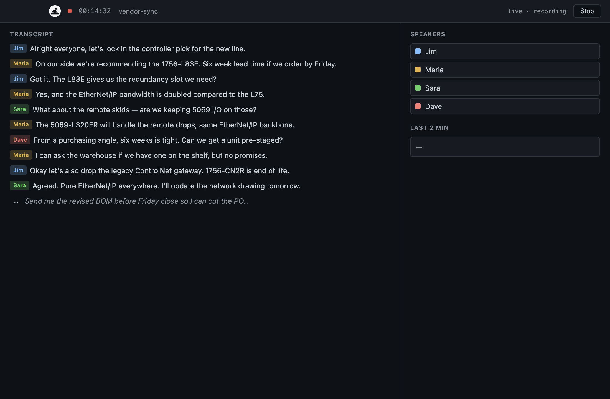

# Cairn

Live meeting transcription with speaker diarization, in the browser.



*Screenshot with demo data, from an earlier build.*

## What it is

Cairn captures audio from a chosen input in the browser, streams it to a transcription service, and shows a live transcript in which every line is attributed to a speaker. While the meeting runs it shows rolling summaries. When you stop, it adds a final summary: a TL;DR, what each speaker contributed, decisions and action items.

This repository holds the web client and the test harness. The service that does the speech-to-text, speaker diarization and summarization, cairn-svc, is a separate project and is not in this repo. The client talks to it over one WebSocket and a few HTTP routes on its own origin. Without that service the page loads but cannot transcribe.

## What it does

- **Live capture.** `getUserMedia` with echo cancellation, noise suppression and auto gain off. An AudioWorklet mixes down to mono, resamples to 16 kHz and sends 16-bit PCM in 3-second chunks. The input device is picked in the title bar and remembered by label, because Safari changes device ids between sessions. A loopback device such as BlackHole lets it transcribe system audio.
- **Transcript.** Partial lines update in place and become final lines with an elapsed-time stamp and a colored speaker pill. Consecutive finals from one speaker are joined when a sentence was cut in the middle and the gap is under 300 ms.
- **Corrections as they arrive.** The service can merge two speakers, relabel one line, or split a line between speakers; the client rewrites the transcript and speakers panel to match.
- **Editing.** Click a line to edit its text (Enter saves, Esc cancels). Click a speaker pill to move the line to another or a new speaker. Edits are logged as `transcript_edit` events in the saved session, and an edited line is not overwritten by later updates to that line.
- **Speakers panel.** Rename and recolor speakers. Names are substituted into the summaries, including variants such as "Speaker 2", and baked into the saved session.
- **Summaries.** Rolling summary cards, newest first, each covering a time window and replaceable in place when the service revises it. A final summary view has a Transcript / Summary toggle, and a banner if the transcript was truncated before summarizing.
- **Saving.** When the service acknowledges a stop, the client POSTs the event log to `/sessions`. It posts again if the final summary arrives late or a speaker is renamed afterwards.
- **URL parameters.** `?meeting_name=...` names the session and `?autostart=1` starts recording on load. Light and dark themes follow the system setting.

## How it works

The client is a static bundle (`index.html`, compiled modules, `style.css`, the audio worklet and icons) that expects to be served from the same origin as the service, with assets under `/assets/`. It opens a WebSocket to `/ws/transcribe` on that origin, using `wss` when the page is on https.

Client to service: a JSON `start` message with the meeting name, binary audio chunks, `stop`, and `speaker_rename`. Service to client: `transcript_partial`, `transcript_final` (with per-word timings), `speaker_assigned`, `speaker_merge`, `speaker_relabel` and `transcript_split` (single and batched), `rolling_summary` and `rolling_summary_replace`, `final_summary`, `ack`, `error`, `control_stop` (ends the session from the server side) and heartbeats. The typed protocol is in `src/renderer/ws.ts`. The client also posts progress diagnostics to `/control/diag`.

The repo's design documents describe the service as a FastAPI app that runs voice-activity detection and Whisper transcription, diarizes with pyannote.audio (with a full-session pass again at stop), and summarizes with an LLM served by Ollama.

In `src/renderer/`: `app.ts` is the session state machine (idle, recording, stopped), device picker, message dispatch and saving. `ws.ts` has the message types and WebSocket wrapper. `audio.ts` and `audio-worklet.js` do capture and resampling. `transcript.ts` is the transcript view (coalescing, relabel, merge, split, editing, and a `snapshot()` the harness reads). `speakers.ts` is the speakers panel, including manually added speakers `M1`, `M2`, and so on. `summary.ts` and `speaker-substitute.ts` render the summaries and substitute speaker names.

## How to run it

```bash
npm install
npm run build      # tsc -p tsconfig.renderer.json, writes dist/renderer/
npm run deploy     # build, then scripts/deploy-ui.sh
```

`scripts/deploy-ui.sh` stages `index.html` plus an `assets/` folder (compiled JS, `style.css`, `audio-worklet.js`, icons), copies it with rsync to the machine that runs the service, and restarts the service over ssh. The target is hard-coded in the script, so edit it for your setup. Then open the service's address in a browser, optionally with `?meeting_name=...&autostart=1`.

Tests. The grader needs Python 3.10 or later and only the standard library; its tests need pytest.

```bash
node --test src/renderer/speaker-substitute.test.mjs     # after npm run build; it tests the compiled module
python3 -m pytest scripts/test_grade_transcript.py
```

### The end-to-end harness

```bash
bash scripts/cairn-loop.sh [--url YOUTUBE_URL] [--duration SECONDS] [--out DIR]
python3 scripts/grade-transcript.py --transcript run.json --reference scripts/fixtures/<fixture>.json --out grade.json
```

`cairn-loop.sh` is written for macOS: Safari, AppleScript and an audio loopback device. It starts a session through the service's control endpoints, opens Cairn with autostart, plays a YouTube video as the audio source, stops after the set time, waits for the session to be saved, fetches a transcript snapshot and runs the grader. The environment variables it reads are `URL`, `DURATION`, `OUT_BASE`, `CTRL` (the service's base URL), `MEETING_NAME`, `REFERENCE` and `STOP_WAIT_S`.

`grade-transcript.py` scores two things against a reference fixture. Bleed is the share of finals whose words fall in two or more reference speakers' turns. Speaker accuracy is the share of words whose mapped Cairn speaker matches the reference speaker. It uses word timings when present and falls back to time overlap, auto-calibrates the reference's start offset (`--anchor-sec` and `--no-auto-anchor` override that), and skips accuracy for references with no speaker identities. The `build-reference*.py` scripts make fixtures from a published transcript page and from YouTube auto-captions; `scripts/fixtures/` holds fixtures for 2, 3 and 5 speaker episodes.

`RESULTS.md`, `ACCURACY.md` and `docs/superpowers/reports/` record the measurements. One example from `RESULTS.md`: on a 10-minute slice of a five-speaker episode, strict word-level bleed fell from 32.7% to 11.5% over a ten-step tuning sweep.

## Configuration

- The client has no settings file. It saves the chosen input device in localStorage under `cairn.deviceId` and `cairn.deviceLabel`.
- The service address is the page's own origin; `src/renderer/app.ts` derives the WebSocket URL from `location`.
- The harness variables are listed above. `scripts/qwen-helper.sh` and `scripts/qwen-stats.sh` are a development helper that sends coding subtasks to a local Ollama model and logs the calls; `QWEN_MODEL` sets the model.

## Layout

```
src/renderer/        the web client, index.html, style.css
src/icons/           logo (SVG and PNG)
scripts/             cairn-loop.sh, grade-transcript.py (+ test), build-reference*.py, deploy-ui.sh, fixtures/
benchmarks/          script.json: ground truth for a synthetic four-speaker meeting (the audio is not in the repo)
docs/superpowers/    design specs, implementation plans and a performance report
RESULTS.md, ACCURACY.md   measurements and a comparison of diarization backends
screenshots/         light and dark screenshots with demo data
```

## Status

The client is at version 0.2.0. There are 102 commits from 2026-05-07 to 2026-05-12 and none after that. It began as an Electron desktop app and was converted on 2026-05-11 into the web page described here, with the Electron host code removed in that change.

Known gaps:

- No PWA manifest or service worker. The design document lists iPhone PWA polish as deferred.
- `scripts/record-demos.sh` and `src/renderer/screenshot-fixture.ts` belong to the Electron-era demo mode. The script launches Electron, which is no longer a dependency, and the fixture file is not imported anywhere. `RESULTS.md` and `ACCURACY.md` were also written in the Electron era.
- The harness waits for the final summary by grepping for `"type":"final_summary"` with no space after the colon. `RESULTS.md` says the service writes a space there, so that wait is likely to run to its timeout before the harness carries on.
- The scripts and documents refer to the author's own deployment target. Replace it with yours.
- The service is not published here, so the client cannot be run end to end from this repo alone.
